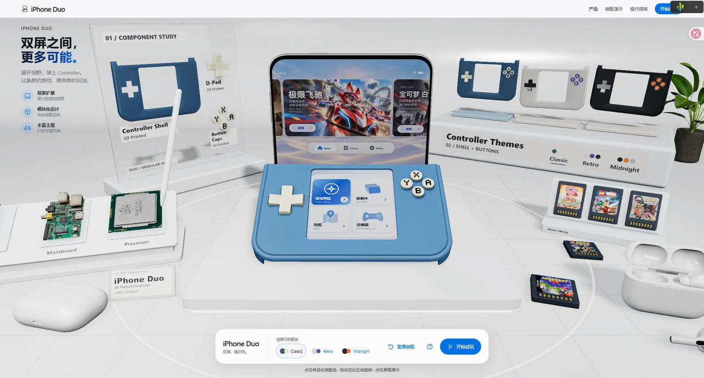
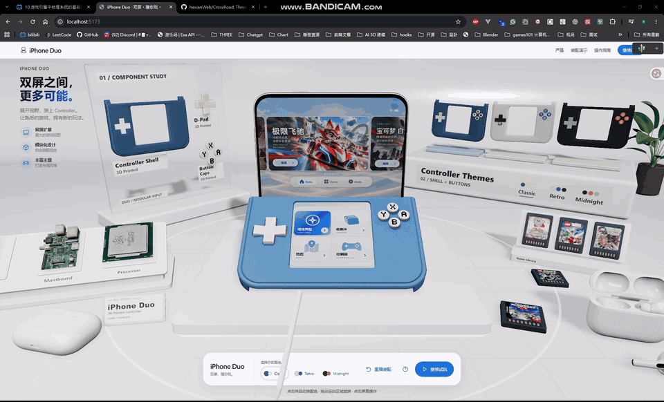

# iPhone Duo · WebGPU × NDS

**从折叠手机，到双屏掌机。**

一个基于 Three.js WebGPU 的 3D 产品交互原型：展开 iPhone Duo，装上模块化 Controller，在同一台 3D 设备上继续游玩 NDS。将产品展示、装配动画与真实双屏游戏连接成一次完整体验。

[快速开始](#快速开始) · [交互指南](#交互指南) · [技术与结构](#技术与结构) · [开发与验证](#开发与验证)



<details>
<summary>查看 NDS 双屏启动演示（GIF）</summary>



[视频版本（MP4，含声音）](docs/img/game-preview.mp4)

</details>

## 项目亮点

- **完整装配演示**：从近闭合状态展开，经过 Controller 滑入、锁定、屏幕切换，进入双屏掌机展示；支持跳过和重播。
- **真实双屏试玩**：集成 WebAssembly NDS 模拟器，将上下屏实时映射到 3D 产品；4:3 主画面保持等比，余区以同帧像素延展填充。
- **输入与实体反馈**：支持键盘、标准手柄和下屏点击 / 拖动触控，ABXY 按压与 D-Pad 倾斜通过阻尼弹簧实时反馈。
- **三套主题配色**：Classic、Retro、Midnight 可通过展区样品或底栏切换，并记住上次选择。
- **可探索的产品展区**：搭配零件、内部元件、卡带与 AirPods 陈列；拖动空白区域可小范围旋转查看，窄屏自动精简周边展品。
- **WebGPU 材质与细节**：TSL 磨砂塑料、清漆键帽、像素印花、烘焙 Lightmap、实时透射与 GTAO 接触遮蔽，以及跟随鼠标的程序化触控笔。

## 快速开始

### 环境要求

- **Node.js**：`^20.19.0 || >=22.12.0`，满足 Vite 8 的运行要求。
- **浏览器**：推荐启用 WebGPU 的最新版 Chrome / Edge，通过 `localhost` 或 HTTPS 访问。项目以 WebGPU 为目标，不提供 WebGL 回退。

### 本地开发

在仓库根目录运行：

```bash
npm install
npm run dev
```

打开终端输出的本地地址，通常为 `http://localhost:5173`。**不加载 ROM 也能体验产品展示、装配与配色。** 首次加载还包含 GPU 渲染管线准备，耗时取决于设备与浏览器。

### 构建与预览

```bash
npm run build
npm run preview
```

产物输出到 `dist/`，包含首页和 `/nds-test.html`。可部署到 HTTPS 静态站点；当前资源 URL 使用站点根路径，部署到子路径前需要适配。

## 交互指南

### 从展示到试玩

1. 等待入场动画完成，或点击页面上的「跳过动画」。
2. 点击右侧 Controller 样品或底栏色板切换配色；点击「重播装配」重新观看演示。
3. 点击「开始试玩」或屏幕内的 Continue 进入游戏。当前六张封面中，**仅第一款（`game0`）开放试玩入口**，其余仅供浏览。
4. 游戏中点击 / 拖动下屏进行触控；按 `Esc` 或点击「返回展区」暂停，再次试玩可接续当前会话。

**ROM 加载方式：**

| 环境 | 首次试玩 |
| --- | --- |
| `npm run dev` | 按 [sources.js](src/js/sources.js) 中的 `ndsSources.testRom` 加载本地测试 ROM；更换测试文件时需同步修改该路径 |
| 生产部署 / `npm run preview` | 点击试玩后，通过文件选择器载入自己有权使用的 `.nds` 文件 |

点击或按键开始试玩时会尝试启用音频。若没有声音，请点击「启用声音」；手柄本身不能解锁浏览器音频。

### 键盘与手柄

| 操作 | 键盘 | 标准手柄 |
| --- | --- | --- |
| 移动 | 方向键 | D-Pad / 左摇杆 |
| A / B | `X` / `Z` | 右侧 / 下侧面键 |
| X / Y | `S` / `A` | 上侧 / 左侧面键 |
| L / R | `Q` / `W` | 左 / 右肩键 |
| Start / Select | `Enter` / `Shift` | Start / Select 对应菜单键 |
| 暂停并返回展区 | `Esc` | 使用页面「返回展区」按钮 |

Game Home 中可用方向键导航、`Enter` 确认；也可使用手柄 D-Pad 和下侧面键。切换窗口、隐藏页面或打开操作说明会暂停游戏并释放输入，恢复后需要手动继续。

> **会话不等于存档**：暂停后可继续，但刷新页面或更换 ROM 会丢失当前会话；尚未实现持久存档。

## 技术与结构

| 技术 | 用途 |
| --- | --- |
| JavaScript ESM + Vite 8 | 模块组织、开发服务与静态构建 |
| Three.js WebGPU + TSL | 实时场景、Node Material、屏幕效果与后处理 |
| GSAP | 入场、装配、镜头与屏幕转场时间线 |
| Tweakpane | 开发环境中的模型、材质、灯光与动画调试 |
| pilas-melonds / melonDS WASM | NDS 运行、帧缓冲、输入与音频桥接 |

```text
src/
├─ index.html           # 产品展示入口
├─ nds-test.html        # 独立 NDS 验证页
├─ main.js
├─ js/
│  ├─ Experience.js     # 单例与全局生命周期
│  ├─ sources.js        # 资源声明与开发测试 ROM 地址
│  ├─ Core/             # 渲染、镜头、加载、管线准备与性能采样
│  ├─ World/            # 产品、展区、输入、屏幕与动画编排
│  ├─ NDS/              # 模拟器、双屏纹理与音频适配
│  ├─ Materials/        # 透射材质扩展
│  └─ Utils/            # 尺寸、时间、资源、状态与事件
└─ shaders/             # 可复用 TSL 效果
public/                 # 模型、纹理、离线标签与本地模拟器产物
scripts/                # 定向验证与资源生成工具
docs/                   # 产品规格、实现记录与优化报告
```

`Experience` 统一初始化与驱动渲染循环，`World` 负责组件装配；DOM UI 通过事件表达操作意图，`InputRouter` 统一路由语义输入，`ScreenManager` 协调手机、菜单和游戏画面。组件沿同一条生命周期链更新、响应尺寸变化并释放资源。

## 开发与验证

### 调试入口

仅在开发环境生效，生产构建不启用：

| 地址 | 功能 |
| --- | --- |
| `/?debug` | 按需加载 Tweakpane、模型检查器与灯光辅助对象 |
| `/?performance` | 采样加载阶段、帧间隔、CPU 提交耗时与 draw calls |
| `/?debug&performance` | 同时启用调试与性能采样 |

### 基础与定向检查

```bash
npm run build
node scripts/verify-nds-mapping.mjs
node scripts/verify-pipeline-preparation.mjs
node scripts/verify-button-materials.mjs
node scripts/verify-labels.mjs
node scripts/verify-textures.mjs
```

以上定向脚本无需 ROM。检查生产资源时，可在构建后为 `verify-labels.mjs`、`verify-textures.mjs` 追加 `--dist`。

使用自己的 ROM 检查真实 WASM 核心：

```bash
node scripts/verify-nds.mjs "path/to/your-game.nds"
```

开发或预览时访问 `/nds-test.html`，可在不加载 3D 场景的情况下验证双屏 Canvas、触控、键盘和音频，便于区分模拟器问题与场景合并负载问题。

构建与脚本检查不能替代支持 WebGPU 的浏览器实测。画面、动画、声音与真实手柄仍需单独验收；构建时的大 chunk 警告本身不代表失败。

### 资源维护

公共资源统一放在 `public/`，由 `src/js/sources.js` 声明。日常开发和构建直接使用已生成资源，无需运行生成工具。

- **展品标签**：`public/labels/` 保存离线 PNG；预设配色直接切图，仅自定义调色按需创建 Canvas。修改文案或排版后的生成命令、Chrome 与参考字体要求见 [标签离线化记录](docs/LABEL_TEXTURE_OPTIMIZATION_2026-10-29.md#生成与维护)。
- **优化纹理**：`public/optimized/` 保存派生素材及校验清单，原始大图保留用于重生成，生产构建排除被替代的原件。流程见 [纹理优化记录](docs/TEXTURE_OPTIMIZATION_2026-10-28.md)。
- **模拟器产物**：固定上游版本，存放在 `public/vendor/pilas-melonds/`，按需加载，不属于 npm 依赖。

## 项目定位与资源许可

本项目是产品概念与交互技术原型，不是 Apple 或 Nintendo 官方产品，也不以完整手机系统、3DS 模拟或通用游戏库为目标。性能和兼容性取决于设备、浏览器及 ROM，不承诺所有游戏或移动设备均可流畅运行。

NDS 核心来自 [pilas-melonds](https://github.com/josepilas/pilas-melonds) / melonDS，上游声明 MPL-2.0。固定版本、许可证及预编译产物的来源与分发注意事项见 [NOTICE](public/vendor/pilas-melonds/NOTICE.md) 和 [LICENSE](public/vendor/pilas-melonds/LICENSE)。模拟器许可不覆盖游戏 ROM、封面、音乐或其他模型与美术资源的使用和再分发权。

> **发布前注意**：`public/nds/` 已从生产构建中排除，但当前仍有 ROM 被 Git 跟踪，不能视作已从仓库排除。公开仓库或部署前，请分别核查 ROM 与各项素材的授权；不要将构建排除当成许可清理。

## 项目文档

- [产品规格与运行时约束](docs/iPhone_Duo_NDS_PRD.md)
- [实现进度与验收记录](docs/PROJECT_PROGRESS.md)（以最新追加记录为准）
- [NDS 接入验证](docs/NDS_Integration_Spike.md)
- [展区设计与实施](docs/Scene_Detail_Implementation_Plan.md)
- [真实渲染管线准备与启动优化](docs/PREPARATION_PROFILE_2026-10-28.md)
- [按键材质节点复用](docs/BUTTON_MATERIAL_OPTIMIZATION_2026-10-29.md)
